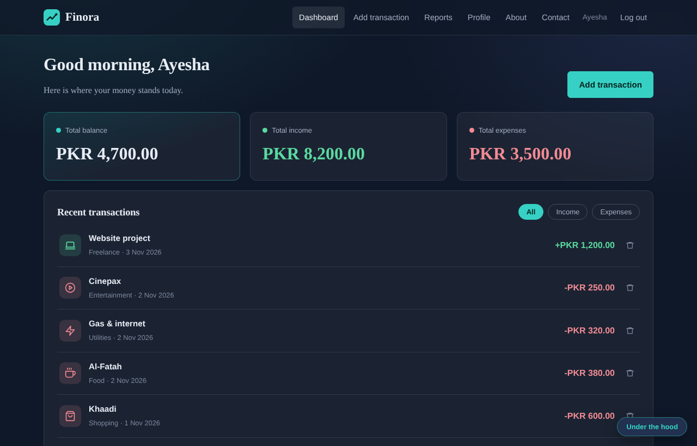

# Finora - Personal Finance Management System

A full-stack personal finance web app: record income and expenses, see your balance on a live dashboard and compare months in visual reports.

| Layer | Technology | Where |
|---|---|---|
| **Frontend** | HTML5, CSS3, vanilla JavaScript (9 pages) | `public/` |
| **Backend** | Node.js + Express REST API | `server/` |
| **Database** | SQLite (Node's built-in `node:sqlite`) | `server/data/finora.db` |



## Quick start

Requires **Node.js 22.13 or newer**.

```bash
npm install
npm start          # http://localhost:3000
npm test           # 17 automated tests
```

**Demo account:** `demo@finora.com` / `Demo@1234` (created automatically; Income 8,200, Expenses 3,500, Balance 4,700).

## How the three layers connect

```
 Browser (public/*.html + js/*.js)
      |  fetch('/api/...')  JSON over HTTP, login cookie
      v
 Express server (server/server.js)
      |  routes -> validation -> SQL (prepared statements)
      v
 SQLite database (server/data/finora.db)
```

Press the **"Under the hood"** button (bottom right of every page) to watch the API calls live.

Example - saving an expense:
1. `expense.html` + `js/expense.js` validate the form and send `POST /api/transactions`.
2. `server/auth.js` reads the httpOnly JWT cookie, `server/validate.js` re-validates, `server/routes/transactions.js` runs a parameterised `INSERT` tied to your user id.
3. `dashboard.js` calls `GET /api/summary`, the server sums your rows and the page redraws.

## Project structure

```
public/            FRONTEND  home, login, signup, dashboard, expense, report, Aboutus, profile, Contactus (.html)
  css/app.css      design system (navy + teal, Georgia / Arial)
  js/app.js        shared helpers: api client, navbar, validation, toasts, inspector
  js/<page>.js     one script per page
server/            BACKEND
  server.js        Express app, security headers, page guard, static files
  auth.js          bcrypt + JWT cookie session
  db.js            SQLite schema (users, transactions, contacts)
  validate.js      server-side validation
  routes/          auth, transactions (+summary, reports), profile, contact
  seed.js          demo account
tests/api.test.js  17 automated tests
```

## API

| Method | Endpoint | Auth | Purpose |
|---|---|---|---|
| POST | `/api/auth/signup` | - | Create account |
| POST | `/api/auth/login` | - | Log in (sets cookie) |
| POST | `/api/auth/logout` | - | Log out |
| GET | `/api/auth/me` | yes | Current user |
| GET | `/api/summary` | yes | Balance, income, expenses, recent |
| GET / POST | `/api/transactions` | yes | List (filters: `type`, `month`, `limit`) / add |
| DELETE | `/api/transactions/:id` | yes | Delete own entry |
| GET | `/api/reports?months=6` | yes | Monthly comparison + category breakdown |
| GET / PUT / DELETE | `/api/profile` | yes | View / edit / delete account |
| PUT | `/api/profile/password` | yes | Change password |
| POST | `/api/contact` | - | Contact form |
| GET | `/api/health` | - | Health check |

## Security

bcrypt password hashing - JWT in httpOnly + SameSite cookie - server-side validation on every input - parameterised SQL - per-user data isolation - login rate limiting - Helmet security headers with a strict Content-Security-Policy - private pages redirect to login on the server - all user text is HTML-escaped when rendered.

## Deploying from GitHub

GitHub itself only hosts static files (GitHub Pages), so it cannot run the Node.js backend. Use one of these - both start straight from your GitHub repository:

**Option A - Render (permanent public URL, free plan)**
1. Push this folder to a GitHub repository.
2. On render.com choose **New + > Blueprint**, select the repo. `render.yaml` configures everything (build, start, health check, `JWT_SECRET`).
3. Open the URL Render gives you. The demo account is created on start.

**Option B - GitHub Codespaces (runs on GitHub's servers, nothing local)**
1. On the repo click **Code > Codespaces > Create codespace**.
2. `.devcontainer` installs dependencies and runs `npm start`; open the forwarded port 3000.

> Free hosts have temporary disk: the SQLite file resets when the service restarts or redeploys (the demo account is re-created automatically). For permanent data attach a persistent disk and set `DB_PATH`, or move to a hosted database in Phase 2.

## Environment variables

See `.env.example`: `PORT`, `NODE_ENV`, `JWT_SECRET`, `DB_PATH`, `SEED_DEMO`.
